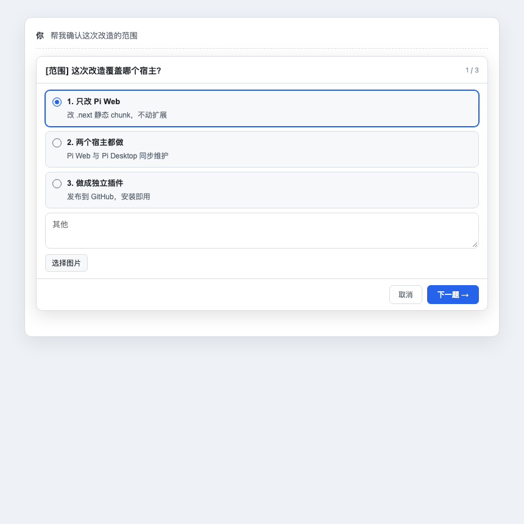
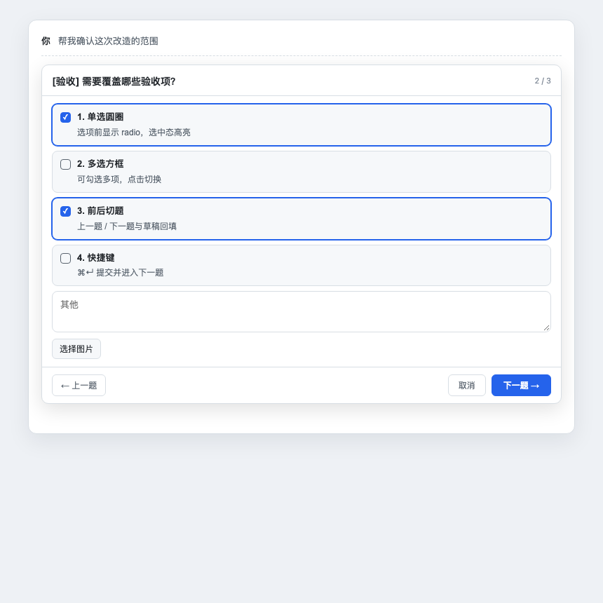
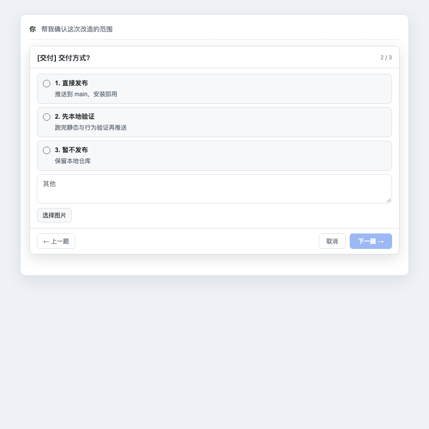

# ask_question

Pi Web 的 `ask_user_question` 插件。把问答做成消息列里的富卡片，并提供单选、多选、前后切题与跨版本自动补丁。

- 仓库：`git@github.com:barry0-0/pi-web-ask_question-.git`
- 上游：`@juicesharp/rpiv-ask-user-question` 2.15.0 本地 fork
- 宿主：Pi Web 0.15.x / 0.16.x（`pi` CLI 的 RPC 模式）

> 截图用真实卡片组件做 SSR 渲染，数据是文档示例，不是生产截图。

## 安装

```bash
pi install git:github.com/barry0-0/pi-web-ask_question-@main
```

安装前移走旧的本地扩展，避免两个 `ask_user_question` 重复注册：

```bash
mv ~/.pi/agent/extensions/rpiv-ask-user-question ~/Desktop/rpiv-ask-user-question.bak
```

重启 pi-web 后生效。插件加载时自动给当前 pi-web 打前端补丁，不需要手动执行脚本。

本地开发：

```bash
git clone git@github.com:barry0-0/pi-web-ask_question-.git ~/Desktop/工作/ask_question
cd ~/Desktop/工作/ask_question
```

## 为什么分成两半

| 半边 | 内容 | 位置 |
| --- | --- | --- |
| 逻辑 | 问什么、怎么记答案、状态机 | 本插件（扩展源码） |
| 界面 | 卡片长什么样 | pi-web 自己的前端 chunk |

Pi Web 在 RPC 模式下只给扩展 `ui.select` / `ui.input`。这两个接口渲染成什么样由 pi-web 决定，扩展 API 改不到。所以插件在加载时运行 `host/patch-host.ts`：定位 pi-web 安装目录，用 `host/apply.py` 做结构推导与幂等注入。

升级 pi-web 后 chunk 被覆盖。下一次插件加载自动重打补丁，无需人工干预。

Pi GPUI 0.2.x 用 Rust / GPUI 原生渲染 `extension_ui_request`。它不读 pi-web chunk。插件检测到 `pi-gpui-bridge.ts` 后启用原生步进，用 `ui.select` 的选项行模拟导航与多选。`PI_WEB_NO_OPEN=1` 时强制关闭该层，pi-web 路径不变。

## 功能

### 卡片形态

- 卡片是消息列的普通子元素，随消息滚动。不用 `position:absolute`，不用全屏遮罩，不遮挡最后一条消息。
- 只有图片全屏预览用 `createPortal` 到 `document.body`。
- 题目区显示题干与进度 chip `i / n`。标题里的进度标记是纯文本，卡片解析后从可见文案剥离。
- 选项两行渲染：主行 `label`，次行 `description`。
- 扩展追加的哨兵选项（`Type something.` / `输入内容`）不渲染成按钮，改为常驻「其他」输入框。
- 答完一题后，下一张卡片挂载时自动把消息列置底。只在 `request.id` 变化时执行一次，不打断中途上滚看历史。

### 单选

- 每个选项前是圆圈（radio）。点击只选中并高亮，不立即提交。
- 输入「其他」会高亮输入框并取消选项高亮。



### 多选

- 每个选项前是方框（checkbox）。点击切换勾选，可同时选多项。
- 多选题不再退化成输入框。提交时把勾选项与「其他」文本一起回传。
- 允许只选部分选项。



### 前后切题

- 第 2 题起显示「← 上一题」。非末题显示「下一题 →」，末题显示「提交」。
- 末题提交即结束。没有复核卡，不罗列全部答案。
- 点「← 上一题」只发 `{"__piRich":1,"nav":"back"}`，不当成答案。扩展题号减 1 并重发该题，后续题已收的答案不清空。
- 提交前与回退前都把当前选项高亮、勾选项、「其他」文本、附件写入内存缓存。缓存按 `session` 隔离，同一题重发时自动回填。用户可前后切题查看并改写已填内容。
- 答案按 `questionIndex` 覆盖，排序输出，不产生重复项。



### 必答与快捷键

- 未选且未输入时，「下一题 →」与「提交」呈禁用态。
- `⌘/Ctrl+↵` 由卡片级监听处理。选中选项后按 `⌘↵` 提交并进入下一题。必答校验同样约束快捷键。
- `Enter` 在输入框内只换行，不提交。
- 「取消」或 `Esc` 放弃整份问卷，返回已答部分并标记 `cancelled: true`。
- 单题问卷行为不变：无步进 chip、无上一题、无下一题。

### 图片附件

- `⌘V` 粘贴图片在 `document` 捕获阶段拦截，聊天输入框文字不变。
- 「选择图片」调原生文件选择器。单张上限 2 MB，最多 4 张。
- 点击附件 chip 打开全屏预览。背景点击、`×`、`Esc` 三种关闭方式。预览的 `Esc` 用捕获阶段加 `stopImmediatePropagation`，不连带取消提问。
- 附件以裸 base64 走 `{"__piRich":1,...}` 信封，扩展解码落到临时文件，答案追加 `附件：<路径>`，模型用 `read` 读图。

### 答案兼容

- 无附件时单选回答是纯字符串，与原弹窗一致。
- 有附件时是 `{"__piRich":1,...}` 信封。
- 多选结果用 `selected` 索引数组表达。
- 工具 schema、`buildQuestionnaireResponse` 信封、TUI 路径、`chatMode` 路径都不变。
- 普通 RPC 宿主输入 `/back` 回退上一题；首题输入 `/back` 退化为自定义答案。多选退化为一次选一项，或在自由输入行输入 `1,3; 自定义`。
- Pi GPUI 走原生步进：`← 上一题`、`□` / `☑`、`完成选择 →`、`沿用上次答案 →`。pi-web 富卡片路径不变。

### Pi GPUI 原生步进

触发条件：`process.argv` 含 `pi-gpui-bridge.ts`，且 `PI_WEB_NO_OPEN !== "1"`。检测失败时保持原路径。

| 控件 | 行为 |
| --- | --- |
| 单选 | 点选项即进入下一题。第 2 题起出现「← 上一题」 |
| 多选 | 选项前显示 `□` / `☑`。点一次切换勾选；点「完成选择 →」提交 |
| 回填 | 回看时标题显示 `上次：…`；多选项恢复 `☑`；可点「沿用上次答案 →」直接沿用 |
| 自定义 | 点自由输入行（默认 `Type something.`），在消息输入框写字后按 Enter |
| 必答 | 未勾选项且未输入时，点「完成选择 →」重问当前题 |
| 取消 | Esc 放弃整份问卷 |

Pi GPUI 用原生列表行与 `□` / `☑` 文本标记，不提供 radio 圆圈、原生 checkbox 或 `⌘↵`。数字键、方向键、Enter 由 Pi GPUI 自己处理。此层只改扩展状态机；Pi GPUI 自动更新不会覆盖。

### 跨版本自动适配

`host/apply.py` 不写死压缩变量名。它用结构正则从官方原文推导：

| 项 | 例子（0.15.x → 0.16.x） |
| --- | --- |
| 请求变量 | `eK` → `eV` |
| 对话框组件 | `d_` → `ck` |
| 等待数 / 回调 | `eV` / `eX` → `eZ` / `e0` |
| react-dom 变量 | `ty` → `tz` |
| 注入锚点 | `function d_(e){` → `function ck(e){` |

推导结果生成三处替换，并把补丁源码里的 `__PW_REACT__` / `__PW_REACT_DOM__` 占位符代入实际变量名。已验证 0.15.x、0.16.x，以及模拟 0.17 变量名整组替换的场景，推导与注入均通过。

注入前干跑校验，写前备份，写后 `node --check` 并回读比对。补丁块里带元数据，重跑可精确剥离，幂等不叠加。

只剩一种情况需人工：Next.js 把渲染**结构**本身改了，不只是变量名。此时推导失败，插件写日志并跳过注入，不猜测、不弄坏服务。服务与 ask 逻辑照常可用。

日志：`~/Library/Logs/pi-web-ask_question.log`。

## 目录

| 路径 | 内容 |
| --- | --- |
| `index.ts`、`*.ts`、`state/`、`tool/`、`view/`、`locales/` | 扩展源码 |
| `host/patch-host.ts` | 插件加载时自动定位与注入 |
| `host/apply.py` | 结构推导、幂等注入、备份、语法校验 |
| `host/rich_dialog_web.js` | 富问卷卡片源码 |
| `host/verify.cjs` | 前端静态与 SSR 验证 |
| `tools/verify-rpc.cjs` | 扩展状态机行为验证 |
| `tools/apply.sh`、`bootstrap.sh`、`deploy.sh`、`rollback.sh` | 手动注入、启动器自愈、同步、回滚 |
| `tools/make-screenshots.cjs` | 重新生成文档截图 |
| `snapshot/` | 扩展源码副本，供启动器自愈 |
| `meta/screenshots/` | 文档截图 |
| `meta/ACCEPTANCE.md` | 验收证据 |
| `meta/UPSTREAM-*.md` | 上游说明与补丁历史 |

## 验证

```bash
cd ~/Desktop/工作/ask_question

node host/verify.cjs                                  # 前端纯函数、信封、SSR
node --experimental-strip-types tools/verify-rpc.cjs  # 扩展状态机
python3 host/apply.py --check                         # 默认安装路径干跑
python3 host/apply.py --check --app-dir <chunks/app>  # 指定版本干跑
./tools/apply.sh                                      # 备份 + 注入
./tools/deploy.sh --capture && ./tools/deploy.sh      # 刷新快照并同步运行时副本
node tools/make-screenshots.cjs                       # 重新生成截图
```

`AGENTS.md` 是项目操作卡。`meta/ACCEPTANCE.md` 记录每次注入的 sha256 与验证结果。

## 配置

配置文件 `~/.config/rpiv-ask-user-question/config.json`，读而不写。

| 项 | 默认 | 说明 |
| --- | --- | --- |
| `chatMode` | `off` | `auto` / `always` 把问题发到对话里由用户在输入框回答，不使用富卡片 |
| `recordTranscript` | `true` | 把问答写成自定义 transcript 条目 |
| `collapseKey` | `ctrl+]` | 终端 TUI 折叠快捷键 |
| `notesKey` | `n` | 终端 TUI 笔记快捷键 |
| `guidance.*` | 内置 | 覆盖模型看到的工具描述 |

## 已知限制

- 未来 pi-web 大版本若改了 React 调用结构，需新增一套结构规则。脚本会明确告警。
- 草稿缓存只在页面内存。硬刷新会丢未提交输入；已提交答案保存在扩展状态机中。
- 浏览器拿不到真实文件路径，附件只能走 base64。
- 真实浏览器点击流、多显示器缩放、无图片剪贴板场景未逐项人工走查。
- Pi GPUI 用 `□` / `☑` 文本标记，不提供原生 radio / checkbox；`⌘↵` 不可用。
- Pi GPUI 的 Enter、数字键、方向键由宿主处理；插件只接收选中字符串。

## 回滚

| 范围 | 命令 |
| --- | --- |
| 前端补丁 | `./tools/rollback.sh --strip` 或 `./tools/rollback.sh` |
| 启动器 | 用 `backups/launcher.bak-*` 恢复并重签名 |
| 插件 | 把备份的 `rpiv-ask-user-question` 移回 `~/.pi/agent/extensions/` |

## 许可

MIT。上游说明见 `meta/UPSTREAM-README.md`。
